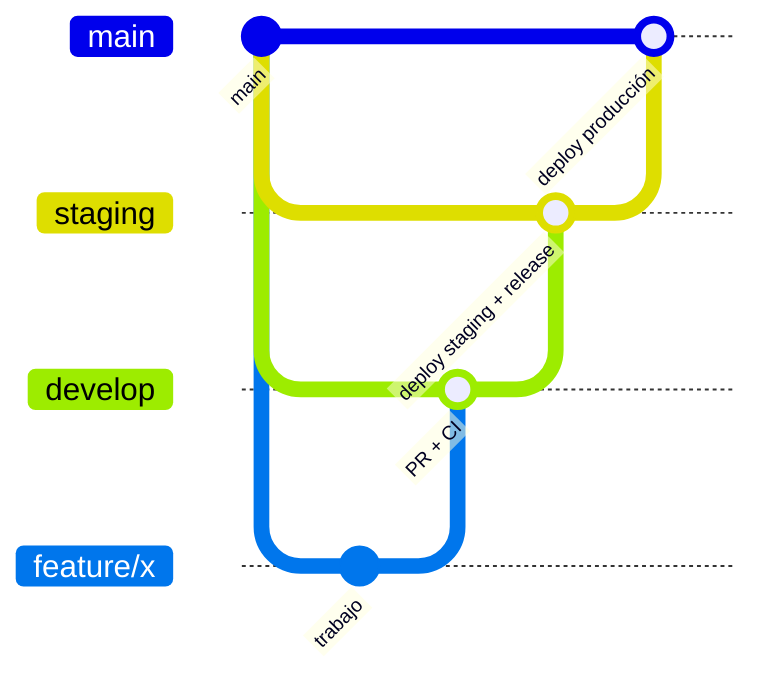
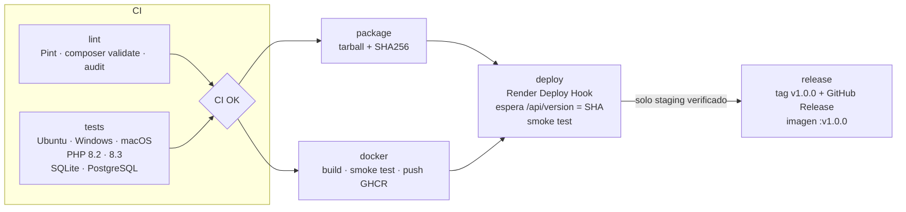

# El Pinguin API

[](https://github.com/Sosa1716/LaravelApp/actions/workflows/deploy.yml)


API REST para la gestión de un restaurante: los **meseros** registran órdenes desde la app móvil,
**cocina** las ve y actualiza su estado, y el **administrador** gestiona el menú, las mesas y los pagos.

El proyecto se entrega con un flujo **DevOps** completo: integración continua multiplataforma,
imagen Docker publicada en GHCR, despliegue continuo a Render (staging y producción) con
verificación automática, y release versionado.

---

## Contenido

- [Stack](#stack)
- [Estructura del proyecto](#estructura-del-proyecto)
- [Puesta en marcha local](#puesta-en-marcha-local)
- [Pruebas y calidad](#pruebas-y-calidad)
- [Flujo de ramas](#flujo-de-ramas)
- [Pipeline de CI/CD](#pipeline-de-cicd)
- [Entornos y configuración](#entornos-y-configuración)
- [API](#api)
- [Documentación adicional](#documentación-adicional)

## Stack

| Capa | Tecnología |
|---|---|
| Framework | Laravel 12, autenticación por token con Laravel Sanctum 4 |
| Lenguaje | PHP 8.2 / 8.3 |
| Base de datos | PostgreSQL 16 (producción), SQLite (staging, local y pruebas) |
| Servidor | FrankenPHP 1.x (Caddy + PHP 8.3) en Docker, usuario sin privilegios |
| CI/CD | GitHub Actions, un solo workflow: `.github/workflows/deploy.yml` |
| Registro de imágenes | GitHub Container Registry (`ghcr.io/sosa1716/laravelapp`) |
| Hosting | Render.com (Blueprint `render.yaml`) |
| Calidad | PHPUnit 11, Laravel Pint, `composer audit`, Dependabot |

## Estructura del proyecto

```text
.
├── .github/
│   ├── workflows/deploy.yml      # Pipeline único: CI → build → deploy → release
│   ├── dependabot.yml            # Actualizaciones semanales de dependencias
│   ├── CODEOWNERS                # Revisores obligatorios
│   ├── pull_request_template.md
│   └── ISSUE_TEMPLATE/
├── app/
│   ├── Http/Controllers/Api/     # Auth, Categoria, Mesa, Orden, Pago, Platillo
│   ├── Http/Middleware/RoleMiddleware.php
│   └── Models/
├── database/
│   ├── migrations/
│   └── seeders/                  # Roles, usuarios, menú, mesas y órdenes demo
├── docker/
│   ├── entrypoint.sh             # Migraciones, seed opcional, cachés, FrankenPHP
│   └── php.ini                   # Ajustes de producción y OPcache
├── docs/problemas.md             # Bitácora de problemas encontrados y su solución
├── routes/api.php
├── tests/
│   ├── Feature/                  # Admin, Cocina, sincronización móvil, health
│   └── Unit/                     # RoleMiddleware
├── Dockerfile                    # Multi-stage: composer → frankenphp
├── docker-compose.yml            # App + PostgreSQL para desarrollo local
├── render.yaml                   # Servicios de staging y producción en Render
└── CHANGELOG.md
```

## Puesta en marcha local

### Opción A: Docker (recomendada, igual a producción)

Requisitos: Docker Desktop.

```bash
cp .env.example .env
php artisan key:generate          # o pega en .env un APP_KEY generado en otra máquina
docker compose up --build
```

- Salud: <http://localhost:8080/up>
- Versión: <http://localhost:8080/api/version>

El contenedor migra la base y carga los datos de demo (`SEED_ON_DEPLOY=true` en `docker-compose.yml`).

### Opción B: PHP local

Requisitos: PHP 8.2+ con `pdo_sqlite`, y Composer 2.

```bash
composer install
cp .env.example .env
php artisan key:generate
touch database/database.sqlite
php artisan migrate --seed
php artisan serve                  # http://localhost:8000
```

### Usuarios de demostración

Los crea el seeder, solo en local y en staging. **Nunca en producción.**

| Rol | Email | Contraseña |
|---|---|---|
| Administrador | `admin@restaurante.com` | `12345678` |
| Mesero | `mesero@restaurante.com` | `12345678` |
| Cocina | `cocina@restaurante.com` | `12345678` |

## Pruebas y calidad

```bash
php artisan test                   # suite completa (SQLite en memoria)
vendor/bin/pint --test             # estilo de código (usa vendor/bin/pint para corregir)
composer audit                     # vulnerabilidades conocidas en dependencias
```

Para correr las pruebas contra PostgreSQL, como lo hace el CI:

```bash
docker run -d --name pg-test -e POSTGRES_PASSWORD=secret -e POSTGRES_DB=testing -p 55432:5432 postgres:16-alpine
DB_CONNECTION=pgsql DB_HOST=127.0.0.1 DB_PORT=55432 DB_DATABASE=testing \
DB_USERNAME=postgres DB_PASSWORD=secret php artisan test
```

## Flujo de ramas



| Rama | Propósito | Qué ejecuta el pipeline al recibir un push |
|---|---|---|
| `feature/*`, `fix/*`, `chore/*` | Trabajo diario | CI completo en el PR hacia `develop` |
| `develop` | Integración | CI + build y smoke test de la imagen + push a GHCR (`:develop`) |
| `staging` | Preproducción | Lo anterior + **deploy a Render staging** + verificación + **release `v1.0.0`** |
| `main` | Producción | Lo anterior + **deploy a producción** (con aprobación manual), imagen `:latest` |

Las tres ramas están protegidas: se requiere PR y el check **`CI OK`**, y no se permite force-push.

## Pipeline de CI/CD

Todo el flujo vive en **[`.github/workflows/deploy.yml`](.github/workflows/deploy.yml)**.



| Job | Cuándo corre | Qué hace |
|---|---|---|
| `lint` | Siempre | `composer validate --strict`, `pint --test`, `composer audit` |
| `tests` | Siempre | Matriz de 12 combinaciones (3 SO × 2 PHP × 2 BD); cobertura con pcov en Ubuntu/8.3/SQLite |
| `ci-ok` | Siempre | Puerta única, requerida por la protección de ramas |
| `package` | Tras `ci-ok` | Tarball de la app con `vendor` de producción + `SHA256SUMS.txt` |
| `docker` | Tras `ci-ok` | Build multi-stage, smoke test del contenedor (`PORT=10000`, login, usuario no-root); en pushes publica en GHCR con SBOM y provenance |
| `deploy` | Push a `staging` o `main` | Llama al Deploy Hook de Render, espera a que `/api/version` devuelva el SHA del commit y ejecuta el smoke test post-deploy |
| `release` | Push a `staging`, solo si `deploy` pasó | Crea el tag y el GitHub Release `v1.0.0` (idempotente) y etiqueta la imagen verificada como `:v1.0.0` |

**Artefactos** (`actions/upload-artifact`), descargables desde cada ejecución:

| Artefacto | Contenido |
|---|---|
| `test-results-<so>-php<v>-<bd>` | Reporte JUnit de cada combinación de la matriz |
| `coverage-report` | Cobertura en Clover y HTML |
| `app-release` | `el-pinguin-api-<sha>.tar.gz` + `SHA256SUMS.txt` |
| `docker-build` | `build-info.json` (imagen, digest, commit), tags y reporte del smoke test del contenedor |
| `deploy-report-<entorno>` | Resultado de la verificación post-deploy |

**Imágenes en GHCR**: `ghcr.io/sosa1716/laravelapp` con los tags `sha-<commit>`, `develop`, `staging`, `main`, `latest` y `v1.0.0`.

## Entornos y configuración

### Render (`render.yaml`)

| Servicio | Rama | Base de datos | Seed en cada deploy |
|---|---|---|---|
| `el-pinguin-api` (producción) | `main` | PostgreSQL gestionado `el-pinguin-db` | No |
| `el-pinguin-api-staging` | `staging` | SQLite dentro del contenedor (efímero) | Sí |

Ambos servicios tienen `autoDeploy: false`: Render solo despliega cuando el pipeline lo dispara,
después de que pasa el CI. En los dos hay que definir **`APP_KEY`** a mano en el panel de Render
(`php artisan key:generate --show`).

### GitHub (Settings → Environments)

| Environment | Secret | Variable | Protección |
|---|---|---|---|
| `staging` | `RENDER_DEPLOY_HOOK_URL` | `APP_URL` (p. ej. `https://el-pinguin-api-staging.onrender.com`) | — |
| `production` | `RENDER_DEPLOY_HOOK_URL` | `APP_URL` | Aprobación manual (required reviewers) |

El Deploy Hook se obtiene en Render → servicio → *Settings* → *Deploy Hook*.
Opcional: la variable de repositorio `RELEASE_TAG` cambia la versión del release (por defecto `v1.0.0`).

### Variables de entorno del contenedor

| Variable | Descripción |
|---|---|
| `APP_KEY` | **Obligatoria.** Sin ella el contenedor no arranca. |
| `PORT` | Puerto HTTP (Render lo inyecta; por defecto 8080) |
| `DB_CONNECTION`, `DB_*` | `pgsql` o `sqlite` |
| `SEED_ON_DEPLOY` | `true` solo en entornos efímeros (staging o local) |
| `APP_VERSION` / `RENDER_GIT_COMMIT` | Commit expuesto en `/api/version` |

## API

Base: `/api`. Las rutas protegidas requieren `Authorization: Bearer <token>`, que se obtiene con `POST /api/login`.

| Método | Ruta | Roles |
|---|---|---|
| `POST` | `/login` | Público |
| `GET` | `/version` | Público |
| `GET` | `/me` · `POST /logout` | Autenticado |
| `GET` | `/platillos`, `/categorias`, `/mesas` (y `/{id}`) | Autenticado |
| `POST` `PUT` `DELETE` | `/platillos`, `/categorias`, `/mesas` | Administrador |
| `GET` | `/ordenes`, `/ordenes/{id}` | Administrador, Mesero, Cocina |
| `POST` | `/ordenes` | Administrador, Mesero |
| `PATCH` | `/ordenes/{id}/estado` | Administrador, Mesero, Cocina |
| `GET` `POST` | `/pagos` | Administrador, Mesero |

Health check: `GET /up`.

## Documentación adicional

- [`docs/problemas.md`](docs/problemas.md): bitácora de cada problema encontrado durante la implementación y su solución.
- [`CHANGELOG.md`](CHANGELOG.md): historial de versiones.

## Licencia

MIT.
